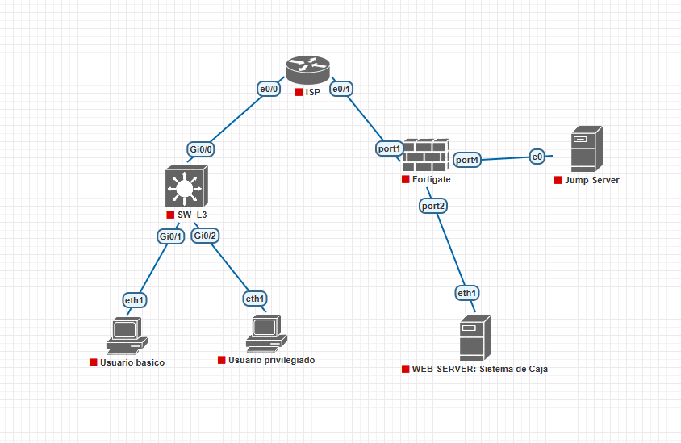
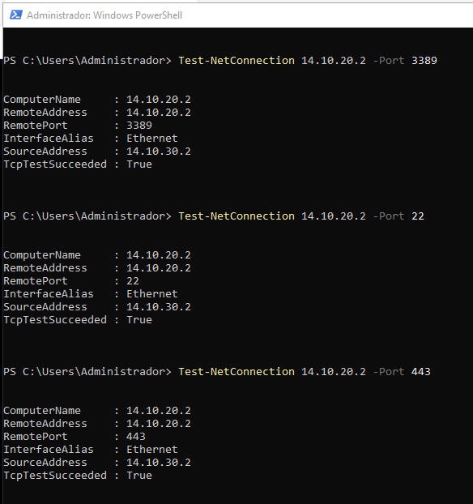
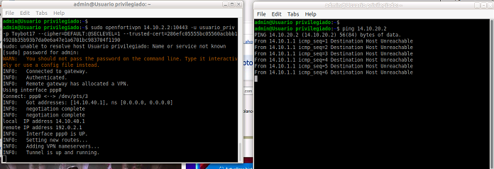
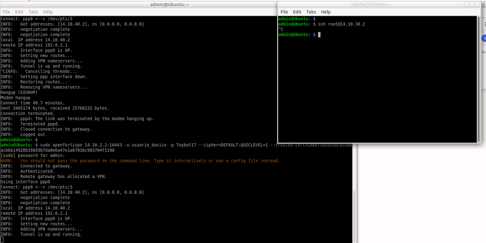
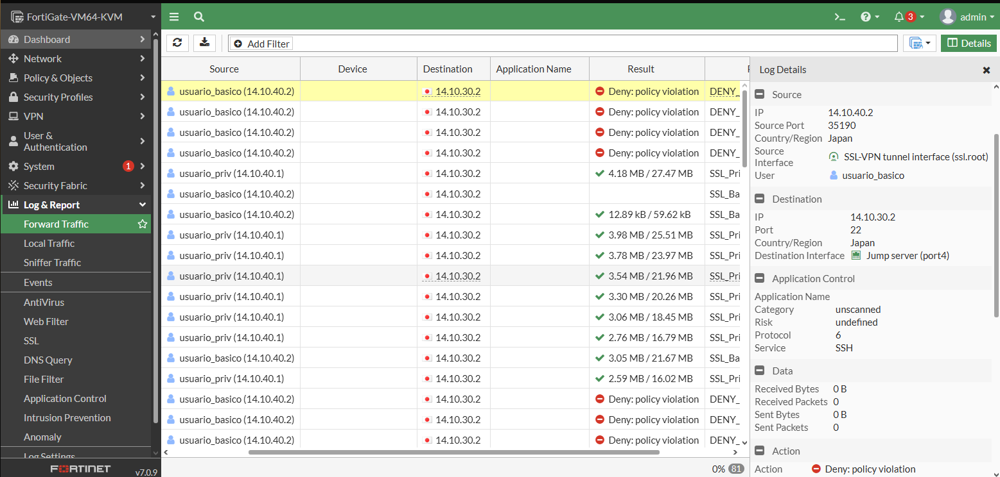
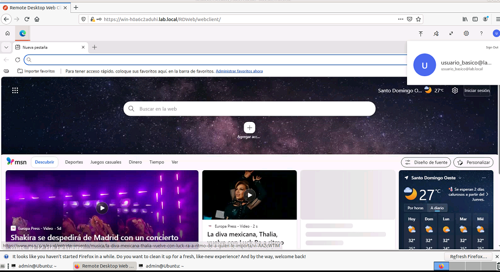
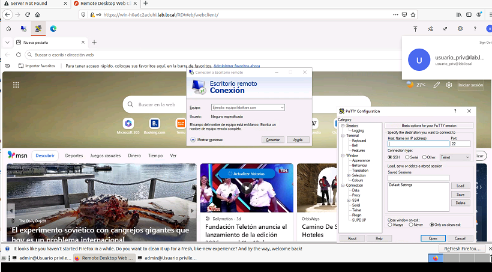
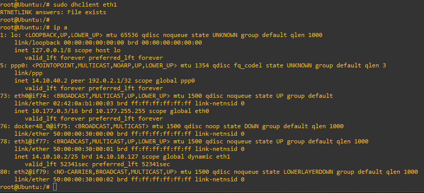
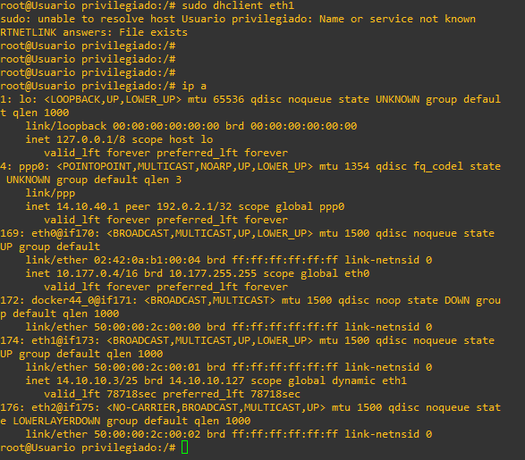
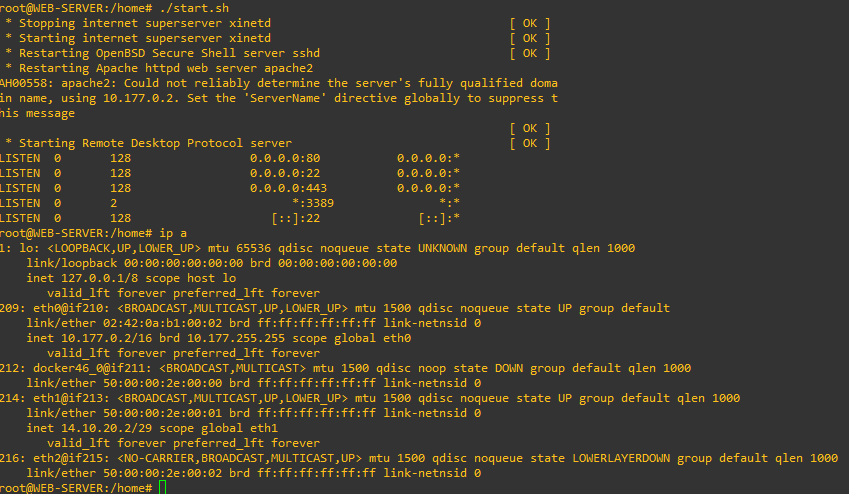

Video: https://youtu.be/8PvFUcSNp9A

## Direccionamiento VLSM 
El proposito de esta topologia es demostrar el funcionamiento de un Jump Server, que sirve para no acceder directamente a un dispositivo.

Matricula: 2025-1410

Red base: `14.10.0.0/16` (últimos 4 dígitos de la matrícula)

| # | Segmento | Red | Máscara | Prefijo | Hosts | Rango útil | Broadcast |
|---|----------|-----|---------|---------|-------|------------|-----------|
| 1 | VLAN 10 (Usuarios) | 14.10.10.0 | 255.255.255.128 | /25 | 126 | 14.10.10.1 - 14.10.10.126 | 14.10.10.127 |
| 2 | Web Server (Sistema de Caja) | 14.10.20.0 | 255.255.255.248 | /29 | 6 | 14.10.20.1 - 14.10.20.6 | 14.10.20.7 |
| 3 | Jump Server | 14.10.30.0 | 255.255.255.248 | /29 | 6 | 14.10.30.1 - 14.10.30.6 | 14.10.30.7 |
| 4 | Pool clientes SSL-VPN | 14.10.40.0 | 255.255.255.240 | /28 | 14 | 14.10.40.1 - 14.10.40.14 | 14.10.40.15 |
| 5 | Enlace Switch L3 - ISP | 14.10.1.0 | 255.255.255.252 | /30 | 2 | 14.10.1.1 - 14.10.1.2 | 14.10.1.3 |
| 6 | Enlace FortiGate - ISP | 14.10.2.0 | 255.255.255.252 | /30 | 2 | 14.10.2.1 - 14.10.2.2 | 14.10.2.3 |

### Asignación de IPs

| Dispositivo | Interfaz | IP | Gateway |
|-------------|----------|----|---------|
| ISP | Ethernet0/0 (hacia Switch L3) | 14.10.1.1/30 | - |
| ISP | Ethernet0/1 (hacia FortiGate) | 14.10.2.1/30 | - |
| Switch L3 | Gi0/0 (hacia ISP) | 14.10.1.2/30 | 14.10.1.1 |
| Switch L3 | Vlan10 (gateway usuarios) | 14.10.10.1/25 | - |
| FortiGate | port1 (WAN, hacia ISP) | 14.10.2.2/30 | 14.10.2.1 |
| FortiGate | port2 (LAN Web Server) | 14.10.20.1/29 | - |
| FortiGate | port4 (LAN Jump Server) | 14.10.30.1/29 | - |
| Web Server (Sistema de Caja) | eth1 | 14.10.20.2/29 | 14.10.20.1 |
| Jump Server (Windows Server) | Ethernet | 14.10.30.2/29 | 14.10.30.1 |
| Usuarios VLAN 10 (DHCP) | - | Pool del switch L3 en 14.10.10.0/25 | 14.10.10.1 |

## Topología

---

## Configuración en el FortiGate (GUI)

### Interfaces

### Rutas estáticas

### Objetos de dirección

### Usuarios

### SSL-VPN

### Políticas de firewall

---

## Pruebas

### Conectividad hacia el Web Server

### Usuario sin privilegios: SSH restringido

### RDP RemoteApp y RemoteApp Web Client

### Servicios publicados por usuario

---

## Detalles de los equipos

### PC usuario sin privilegios

### PC usuario con privilegios

### Web Server: Sistema de Caja

